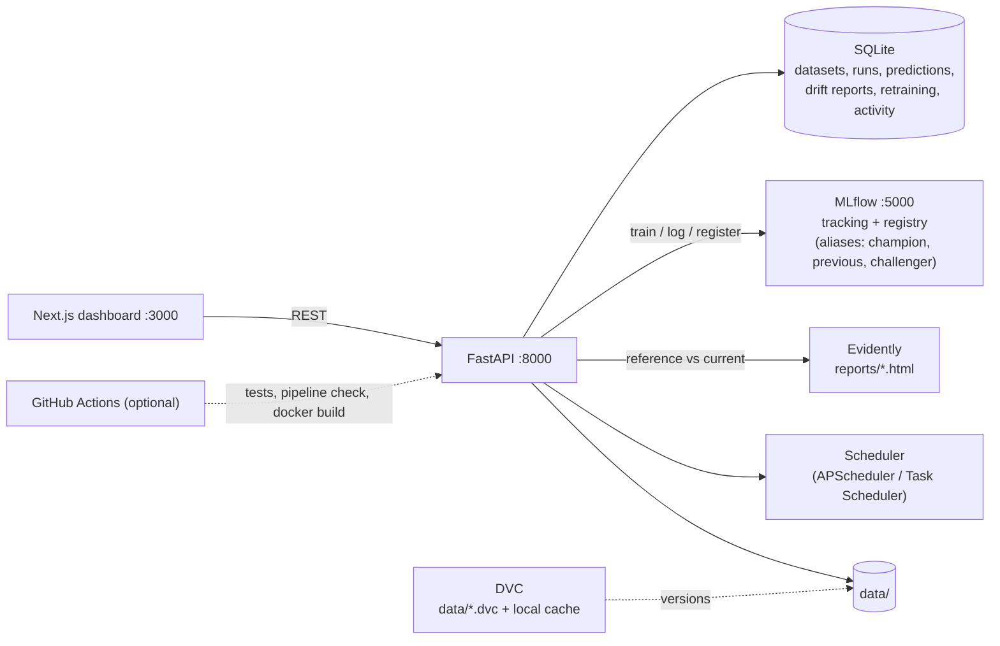
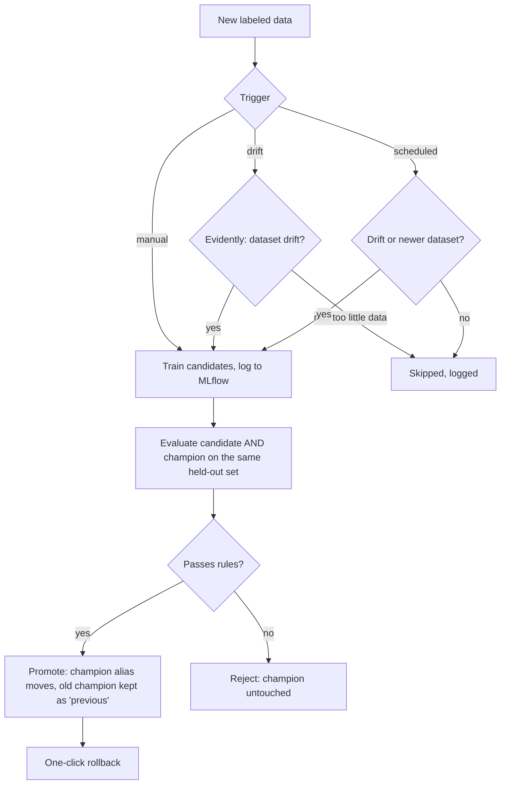

# MLOps — End-to-End MLOps Pipeline for a Deployed Churn Model

A complete, **zero-cost, local-only** MLOps application: upload and version datasets, train and track models, register and promote versions, serve predictions, monitor data drift, and retrain automatically — all through a dashboard.

No cloud account, no paid API, no credit card. Everything runs on `localhost`.

## Technology Stack

| Layer | Tooling |
|---|---|
| Frontend | Next.js 16, TypeScript, Tailwind CSS 4, Recharts, Lucide |
| Backend | FastAPI, SQLAlchemy, Pydantic, SQLite, APScheduler |
| Machine Learning | scikit-learn (Logistic Regression, Random Forest), pandas, NumPy |
| MLOps | DVC (local cache), MLflow (tracking + model registry), Evidently AI (drift), Docker Compose, GitHub Actions |

## Architecture



### Retraining Workflow



**Source of truth:**
- **DVC:** Dataset files and versioning.
- **MLflow:** Experiments, artifacts, model versions, and active model.
- **SQLite:** Application records displayed in the dashboard.
- **Reports:** Evidently-generated HTML reports.

## What Was Verified

| Area | Status |
|---|---|
| Backend tests (unit, API, ML pipeline, prediction, monitoring, retraining, integration) | **36 passed** in a clean virtual environment; `pip check` clean |
| Training on real IBM Telco dataset (7,043 rows) | Tested: ROC-AUC 0.842 (Logistic Regression), 0.837 (Random Forest) |
| DVC `add` + `dvc repro` (local cache, no remote) | Tested |
| MLflow server mode | Tested end-to-end through the backend |
| Evidently drift detection | Tested: no-drift, shifted-data, and insufficient-data cases |
| Frontend | Type-check, 6 unit tests, 11 page tests, production build, and standalone server tested |
| Docker Compose build/up | Not run in the original build environment |
| GitHub Actions | Not run on GitHub; individual job steps were run locally and YAML validated |
| Visual browser testing | Not completed |
| Windows | Developed and tested on Linux; PowerShell scripts remain untested |

Package versions are pinned to compatible versions. Evidently 0.7.x requires `pandas < 3`.

## Quick Start A — Docker

Requires Docker Desktop with the WSL2 backend.

For an 8 GB laptop, consider limiting WSL resources by creating `%UserProfile%\.wslconfig`:

```ini
[wsl2]
memory=3GB
processors=2
```

Then run:

```powershell
wsl --shutdown
docker compose up --build
```

### Application URLs

| Service | URL |
|---|---|
| MLOps Dashboard | http://localhost:3000 |
| Backend API + Swagger | http://localhost:8000/docs |
| MLflow UI | http://localhost:5000 |

Application state is stored in Docker named volumes and the local `data` folder. It survives `docker compose down`. Running `docker compose down -v` deletes the volumes.

## Quick Start B — Without Docker (Windows)

### Prerequisites

- Python 3.12 (Python 3.11 should also work)
- Node.js 22 LTS (Node.js 20 should work)
- Git

### Setup

```powershell
cd C:\dev\mlops360
.\scripts\setup_windows.ps1
.\scripts\start_local.ps1
```

The setup script creates the virtual environment and installs dependencies. The start script opens the MLflow UI, backend API, and frontend dashboard in separate windows.

### Manual Setup

Run the following commands in three separate terminals:

**Terminal 1 — MLflow UI**

```powershell
.\.venv\Scripts\python -m mlflow ui --backend-store-uri sqlite:///C:/dev/mlops360/artifacts/mlflow.db --port 5000
```

**Terminal 2 — Backend API**

```powershell
cd backend
..\.venv\Scripts\python -m uvicorn app.main:app --port 8000
```

**Terminal 3 — Frontend**

```powershell
cd frontend
npm run dev
```

## Five-Minute Demo

1. **Datasets:** Generate a synthetic dataset or download the real IBM Telco dataset.
2. **Model Training:** Train the models. Both algorithms are tracked, and the best model based on ROC-AUC is registered as version 1.
3. **Predictions:** Score a customer. Generate additional traffic using:

   ```powershell
   python scripts/simulate_traffic.py --n 300
   ```

4. **Monitoring:** Run a drift check to view the Evidently report.
5. **Simulate Drift:** Set the monitoring window to 300 in Settings. Run:

   ```powershell
   python scripts/simulate_traffic.py --n 300 --drift
   ```

   Run the drift check again to observe drift detection.

6. **Retraining:** Run a drift-triggered check. The system trains a candidate model and compares it against the current champion.
7. **Model Registry:** Roll back to the previous champion with one click.

The traffic simulation generates labelled-as-synthetic demo traffic through the real prediction endpoint. It does not fabricate monitoring output.

## Key Design Decisions

- **No data leakage:** Imputers, scaler, and encoder are included inside the scikit-learn pipeline and fitted only on the training split.
- **Consistent training and prediction:** The same saved pipeline is used for training and serving.
- **Model versioning:** MLflow aliases manage model promotion. The previous champion is retained.
- **Reliable retraining:** Drift triggers candidate training, but promotion requires the candidate to satisfy performance rules against the existing champion.
- **Honest monitoring:** Insufficient prediction data produces an `insufficient_data` report rather than misleading metrics.
- **API-driven frontend:** Dashboard metrics are retrieved from the backend API.
- **Model persistence:** Models are saved using cloudpickle. Only load models that you trust and trained yourself.

## DVC — Local Dataset Versioning

DVC manages dataset versions using a local cache without requiring a cloud remote.

```powershell
dvc init
python scripts/prepare_data.py
dvc add data/telco_churn.csv
git add data/telco_churn.csv.dvc data/.gitignore params.yaml dvc.yaml
git commit -m "Track dataset v1"
dvc repro
```

For a new dataset version:

```powershell
dvc add data/telco_churn.csv
git commit -am "Dataset v2"
```

No DVC remote is configured. Everything stays in the local `.dvc/cache`.

## Scheduled Retraining

Retraining can be scheduled in two ways:

1. Set **Schedule hours** on the Settings page. The built-in APScheduler runs while the API is active.
2. Use Windows Task Scheduler with:

```powershell
.\scripts\schedule_retraining.ps1 -Time 02:00
```

This calls `scripts/run_retraining.py` and exits with a non-zero status if retraining fails.

## Testing

### Backend Tests

```powershell
cd backend
$env:PYTHONPATH="."
..\.venv\Scripts\python -m pytest -q
```

### Frontend Tests

```powershell
cd frontend
npm run typecheck
npm test
npm run build
```

Backend tests use isolated temporary project directories, SQLite databases, and MLflow stores. They do not require network access.

Frontend page tests use fixtures captured from actual API responses.

## API Overview

Swagger documentation is available at:

`http://localhost:8000/docs`

Main API capabilities include:

- Dataset upload, generation, download, and preview.
- Model training and experiment tracking.
- Model registry, promotion, rejection, and rollback.
- Single and batch predictions.
- Data drift monitoring and report retrieval.
- Automated retraining and history.
- Application settings and activity tracking.
- System health monitoring.

## Project Structure

```text
mlops360/
├── backend/
│   ├── app/
│   │   ├── api/
│   │   ├── core/
│   │   ├── database/
│   │   ├── ml/
│   │   ├── models/
│   │   ├── schemas/
│   │   ├── services/
│   │   ├── monitoring/
│   │   └── retraining/
│   ├── tests/
│   ├── Dockerfile
│   └── requirements.txt
├── frontend/
│   ├── app/
│   ├── components/
│   ├── lib/
│   ├── tests/
│   └── Dockerfile
├── scripts/
│   ├── prepare_data.py
│   ├── train.py
│   ├── simulate_traffic.py
│   └── run_retraining.py
├── data/
├── models/
├── reports/
├── artifacts/
├── mlruns/
├── dvc.yaml
├── params.yaml
├── docker-compose.yml
└── .github/
    └── workflows/
        └── ci.yml
```

## Troubleshooting

- **Cannot reach the backend:** Ensure the API is running on port 8000. Check `NEXT_PUBLIC_API_URL` and `CORS_ORIGINS` if using different ports.
- **MLflow unavailable in Docker:** Allow approximately 20 seconds for startup. Check `docker compose logs mlflow`.
- **MLflow Invalid Host header:** Add your hostname to MLflow's `--allowed-hosts` configuration.
- **pandas installation issue:** Use the pinned version because Evidently 0.7 requires `pandas < 3`.
- **PowerShell blocks Activate.ps1:** Run `Set-ExecutionPolicy -Scope CurrentUser RemoteSigned`.
- **Out of memory:** Use the non-Docker setup during development on machines with limited RAM.
- **Disk usage:** The backend image can be large because it includes MLflow and Evidently.

## Screenshots

Screenshots are not included yet. Add the following dashboard screenshots to `docs/screenshots/` to improve the project presentation:

- Dashboard overview
- Model training results
- Experiment comparison
- Model registry
- Monitoring and drift reports
- Retraining history
- MLflow experiment runs

---

**MLOps** — A local, end-to-end machine learning operations platform built with open-source tools.

<!-- daily-readme-update -->
Last refreshed automatically: 2026-11-24 (UTC)
