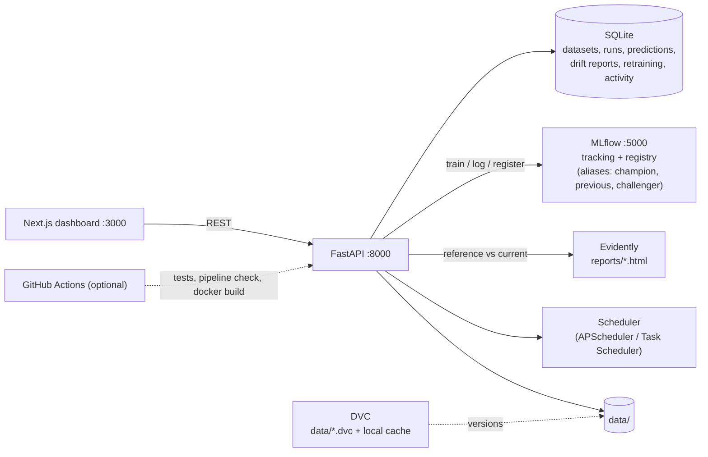
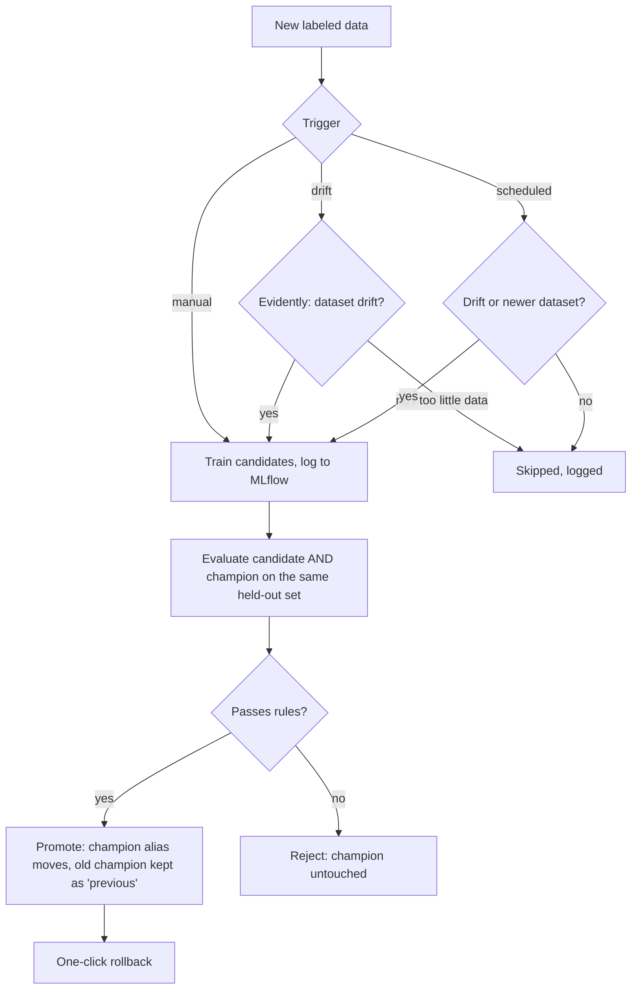

# MLOps360 — End-to-End MLOps Pipeline for a Deployed Churn Model

A complete, **zero-cost, local-only** MLOps application: upload and version datasets, train and track models,
register and promote versions, serve predictions, monitor data drift, and retrain automatically — all through a
dashboard. No cloud account, no paid API, no credit card. Everything runs on `localhost`.

| Layer | Tooling |
|---|---|
| Frontend | Next.js 16, TypeScript, Tailwind CSS 4, Recharts, Lucide |
| Backend | FastAPI, SQLAlchemy, Pydantic, SQLite, APScheduler |
| ML | scikit-learn (Logistic Regression, Random Forest), pandas, NumPy |
| MLOps | DVC (local cache), MLflow (tracking + model registry), Evidently AI (drift), Docker Compose, GitHub Actions |

## Architecture



**Retraining loop**



Source of truth: **DVC** = dataset files · **MLflow** = runs, artifacts, model versions, which version is live ·
**SQLite** = app records the UI reads · **`reports/`** = Evidently HTML.

## What was verified (and what was not)

| Area | Status |
|---|---|
| Backend tests (unit, API, ML pipeline, prediction, monitoring, retraining, integration) | **36 pass**, in a clean virtualenv built from `requirements-dev.txt`; `pip check` clean |
| Training on the **real IBM Telco dataset** (7,043 rows) | Tested: ROC-AUC 0.842 (Logistic Regression), 0.837 (Random Forest) |
| DVC `add` + `dvc repro` (local cache, no remote) | Tested, including `dvc init --no-scm` as used in CI |
| MLflow in **server mode** (the Docker topology: `--serve-artifacts`, remote tracking URI) | Tested end to end through the backend |
| Evidently drift: no-drift case, shifted case, insufficient-data case | Tested |
| Frontend: type-check, 6 unit tests, 11 page tests rendering every page against **real API responses**, production build, standalone server (the Docker run stage) serving all 9 routes | Tested |
| `docker compose build/up` | **Not run** — no Docker in the build environment. The files are written to mirror the steps above, but run `docker compose up --build` once and tell me if anything fails |
| GitHub Actions | **Not run on GitHub.** Each job's steps were run locally; YAML validated |
| Visual check in a real browser / screenshots | **Not done** (see "Screenshots" below) |
| Windows | Developed and tested on Linux. Paths use `pathlib`/`as_posix()` throughout; PowerShell scripts untested |

Package versions are pinned to a combination that was installed and tested together. One real incompatibility
was found and is documented in `requirements.txt`: **Evidently 0.7.x requires pandas < 3**.

## Quick start A — Docker (single command)

Requires Docker Desktop (WSL2 backend). On an 8 GB laptop, limit WSL first — create `%UserProfile%\.wslconfig`:

```
[wsl2]
memory=3GB
processors=2
```
then `wsl --shutdown`.

```powershell
docker compose up --build
```

| Service | URL |
|---|---|
| Dashboard | http://localhost:3000 |
| API + Swagger | http://localhost:8000/docs |
| MLflow UI | http://localhost:5000 |

State is kept in named volumes (`mlflow_data`, `app_artifacts`, `app_models`, `app_reports`) and your `./data`
folder, so it survives `docker compose down`. (`docker compose down -v` deletes the volumes.)
Memory limits: MLflow 1 GB, API 2 GB, frontend 512 MB. The API and MLflow share one image to save disk.

## Quick start B — without Docker (Windows PowerShell)

Prerequisites: Python 3.12 (3.11 should also work), Node.js 22 LTS (20 should work), Git.

```powershell
cd C:\dev\mlops360
.\scripts\setup_windows.ps1      # venv + pip install + npm install
.\scripts\start_local.ps1        # opens MLflow UI, API and dashboard in 3 windows
```

Or manually, in three terminals:

```powershell
# 1) MLflow UI (reads the same local SQLite store the API writes to)
.\.venv\Scripts\python -m mlflow ui --backend-store-uri sqlite:///C:/dev/mlops360/artifacts/mlflow.db --port 5000
# 2) API
cd backend; ..\.venv\Scripts\python -m uvicorn app.main:app --port 8000
# 3) Dashboard
cd frontend; npm run dev
```

## Five-minute demo

1. **Datasets** → *Generate* (synthetic) or *Download dataset* (real IBM Telco; needs internet once).
2. **Model Training** → *Train*. Both algorithms are tracked; the best (by ROC-AUC) is registered as **v1** and goes live.
3. **Predictions** → score a customer. Then in a terminal: `python scripts/simulate_traffic.py --n 300`.
4. **Monitoring** → *Run drift check* → no drift (Evidently report embedded in the page).
5. **Settings** → set *Monitoring window* to `300`. Run `python scripts/simulate_traffic.py --n 300 --drift`, then *Run drift check* again → drift detected. (Use the *synthetic* dataset in step 1 for the clearest demo; the shifted traffic is less obvious against the real IBM data and may stay under the 30% threshold — that is the system correctly refusing to cry wolf.)
6. **Retraining** → *Drift-triggered check* trains a candidate only if drift is confirmed, compares it with the champion on the same held-out data, and promotes or rejects it with a written reason.
7. **Model Registry** → *Roll back* restores the previous champion in one click.

`simulate_traffic.py` generates labelled-as-synthetic demo traffic through the real prediction endpoint; it does not
fabricate monitoring output.

## Key design decisions

- **No leakage**: imputers, scaler and encoder live *inside* the sklearn pipeline and are fit on the training split only. Feature engineering is a pure function (no fitted statistics). Stratified split, fixed seeds (`params.yaml`), and tests that prove both.
- **One code path for training and serving**: the saved pipeline accepts raw customer rows, so predictions can't drift from training logic.
- **Aliases, not stages**: promotion moves the MLflow alias `champion`; the old champion becomes `previous`. Nothing is ever deleted.
- **Drift ≠ degradation**: drift only *triggers* a candidate. Promotion requires the candidate to clear an absolute ROC-AUC floor and beat the champion on F1 and ROC-AUC (margin configurable) on identical held-out data. A model that fails is rejected and the champion stays live.
- **Honest monitoring**: with fewer than *min rows* predictions you get an `insufficient_data` report, never invented numbers.
- **Frontend shows only API data**: no hard-coded metrics anywhere; empty states explain what to do next.
- Models are saved with cloudpickle (needed for the custom feature function). Only load models you trained yourself.

## DVC (local cache, no remote)

```powershell
dvc init                                  # once, inside the git repo
python scripts/prepare_data.py            # downloads IBM data, or generates synthetic if offline
dvc add data/telco_churn.csv
git add data/telco_churn.csv.dvc data/.gitignore params.yaml dvc.yaml; git commit -m "track dataset v1"
dvc repro                                 # trains only if data, code or params changed
# new data version:
dvc add data/telco_churn.csv; git commit -am "dataset v2"
```
Do not add a DVC remote — everything stays in `.dvc/cache`.

## Scheduled retraining

Either set **Schedule hours** on the Settings page (built-in scheduler, runs while the API is up), or use Windows
Task Scheduler: `.\scripts\schedule_retraining.ps1 -Time 02:00` (calls `scripts/run_retraining.py`, which exits
non-zero on failure).

## Tests

```powershell
cd backend;  $env:PYTHONPATH="."; ..\.venv\Scripts\python -m pytest -q     # 36 tests
cd frontend; npm run typecheck; npm test; npm run build                       # 17 tests
```
Backend tests are fully isolated (temporary project root, SQLite and MLflow store) and need no network.
The frontend page tests use fixtures captured from the real API (`frontend/tests/fixtures/`); if you change an API
response shape, regenerate them.

## API overview (Swagger at `/docs`)

`GET /api/overview` · `GET|POST /api/datasets…` (`upload`, `generate`, `download-telco`, `{id}/preview`) ·
`POST /api/train` · `GET /api/experiments` · `GET /api/models` · `POST /api/models/{v}/promote|reject` ·
`POST /api/models/rollback` · `POST /api/predict` · `POST /api/predict/batch` · `GET /api/predictions` ·
`POST /api/monitoring/run` · `GET /api/monitoring/reports[/{id}/html]` · `POST /api/retraining/run` ·
`GET /api/retraining/history` · `GET|PUT /api/settings` · `GET /api/activity` · `GET /api/system` · `GET /api/health`

## Project structure

```
mlops360/
├── backend/app/{api,core,database,ml,models,schemas,services,monitoring,retraining}  tests/  Dockerfile  requirements*.txt
├── frontend/            Next.js app (app/, components/, lib/, tests/) + Dockerfile
├── scripts/             prepare_data, train (DVC entry), simulate_traffic, run_retraining, *.ps1
├── data/  models/  reports/  artifacts/  mlruns/    local state (git-ignored contents)
├── dvc.yaml  params.yaml  docker-compose.yml  .env.example
└── .github/workflows/ci.yml                          backend, frontend, ML pipeline, docker build
```

## Troubleshooting

- **`Cannot reach the backend` in the dashboard** — start the API (`:8000`). If you changed ports, set `NEXT_PUBLIC_API_URL` and rebuild/restart the frontend; add the origin to `CORS_ORIGINS`.
- **MLflow shows `unreachable` in Docker** — it needs ~20 s to start; the API waits for its health check. Check `docker compose logs mlflow`.
- **MLflow "Invalid Host header" (own setups)** — MLflow 3.x validates the Host header; add your hostname to `--allowed-hosts` (already set in `docker-compose.yml`).
- **`pip install` pulls pandas 3** — don't; Evidently 0.7 needs `pandas<3` (pinned).
- **PowerShell blocks `Activate.ps1`** — `Set-ExecutionPolicy -Scope CurrentUser RemoteSigned`.
- **Out of memory on 8 GB** — use Quick start B while developing; keep Docker for demos with the `.wslconfig` limits above.
- **Disk usage** — the backend image is large (~2 GB) because MLflow and Evidently are full-featured libraries; `docker image prune` after rebuilds.

## Screenshots

I could not launch a browser in the build environment, so no screenshots are included. After the demo above, capture
these into `docs/screenshots/` for your portfolio: Overview, Model Training results, Experiments comparison,
Model Registry (champion/previous), Monitoring (drift table + embedded Evidently report), Retraining history,
MLflow UI runs page.

## Limitations (stated plainly)

- Single-user, single-process design (SQLite, in-process scheduler). Right for a laptop and a portfolio; not for multi-replica serving.
- No authentication (localhost only). Don't expose the ports to a network.
- Drift tests are statistical (Evidently defaults); with large samples tiny shifts become "significant" — read the full report.
- The "previous" slot holds one model; older versions stay in MLflow but are `archived` in the UI.
